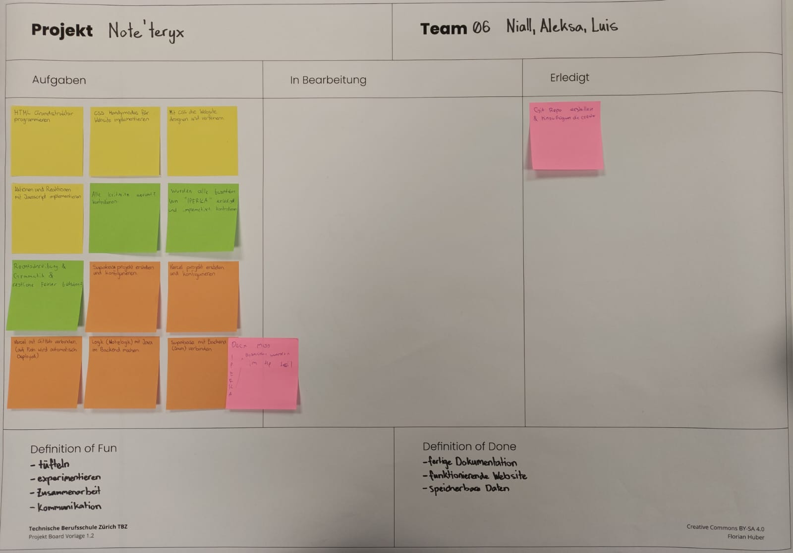

# 10/11/26
wir haben erst angefangen mit unserern projekt. wir machen eine Notiz app wo was immer man notiert wird als md file gespeichert weil sie sehr nützlich sind. wir haben einen coolen namen ausgesucht Note-teryx der insperation von der marke arcteryx nimmt. wir haben dann eine GitHub reposetory gemacht und haben einander eingeladen. wir wollen auf vs code programmieren und documentieren. dann haben wir eine extension von vs code selebr benutzt sodass wir alle drei gleichzeiting auf den file bearbeiten können und es keine merg konflikt passieren wird.  

# 17/11/26

# 24.11.2026

Heute haben wir viele Anregungen bekommen, aber nicht viel am eigentlichen Projekt gearbeitet. Zu Beginn haben wir den 17. November kurz zusammengefasst. Anschließend haben wir uns alle Lösungen angesehen und darüber diskutiert.

Danach haben wir uns mit der Fibonacci-Folge beschäftigt. Sie hilft uns dabei, die Aufgaben in unserem Projekt einzuschätzen und zu strukturieren: Wer übernimmt welche Aufgabe? Wie lange dauert sie? Wie aufwendig ist sie?

Nach dieser Folie der Präsentation haben wir uns die Kanban-Methode angesehen. Außerdem sollten wir eine Mindmap erstellen, die zeigt, wie wir unser Projekt umsetzen wollen. Wir befinden uns derzeit in der Planungsphase.

Anschließend haben wir auf einem Aufgabenblatt mehrere Kriterien ausgefüllt:

Darauf sind die konkreten Schritte unseres Projekts zu sehen. Es zeigt zum Beispiel, dass wir im Backend eine Datenbank zum Speichern der Notizen verwenden wollen und wie JavaScript eingesetzt werden soll.